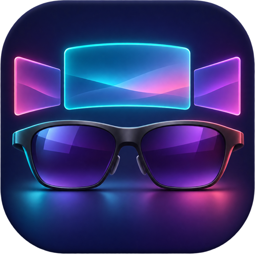
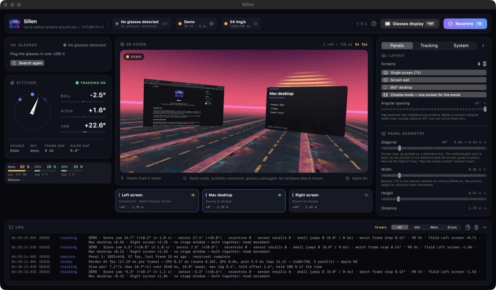
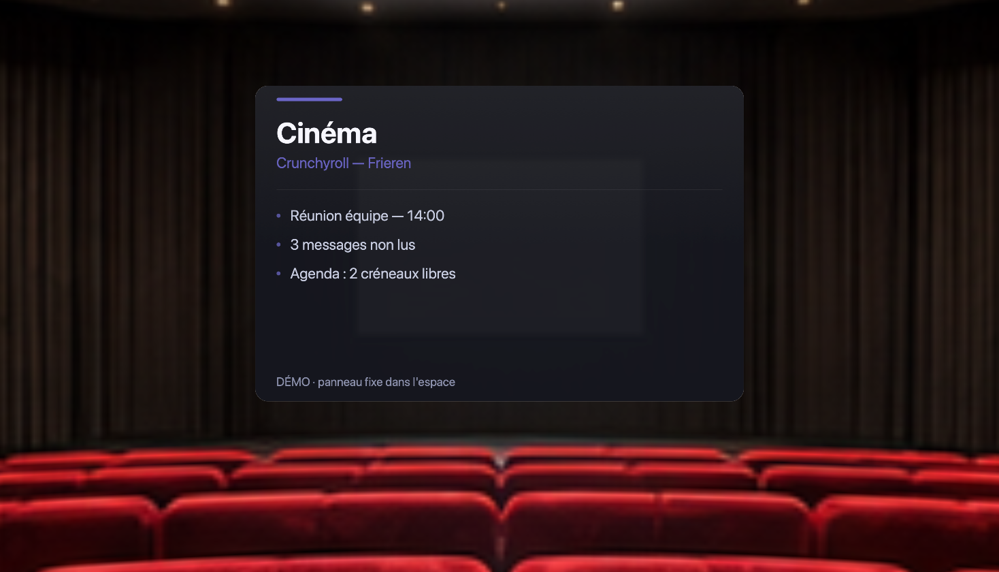
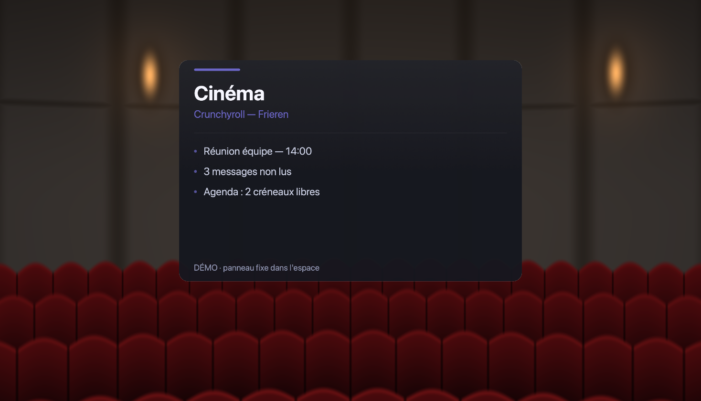

  

<h1 align="center">Sillen</h1>

  Vos fenêtres Mac, posées dans l'espace. 
  Une application macOS pour travailler et regarder des films avec des lunettes XR.

  <a href="README.md">English</a>

---

## Ce que c'est

Sillen récupère de **vraies fenêtres de votre Mac** — un navigateur, un mail, une
messagerie, un tableau de bord — et les affiche dans un espace en trois
dimensions, devant vous. Ce ne sont pas des copies figées : ce sont les fenêtres
elles-mêmes, mises à jour en continu, avec lesquelles vous interagissez.

Vous tournez la tête, la scène suit. Vous posez un écran à gauche, il reste à
gauche. Vous en voulez un troisième, un quatrième, plus loin ou plus grand :
c'est un réglage, pas une reconstruction.

## Ce qu'on peut faire

**Poser ses écrans où l'on veut.** Un à douze panneaux, disposés sur un
arc devant vous, à la taille et à la distance de votre choix. Chaque panneau
suit une vraie fenêtre : si vous changez d'onglet, le panneau change.

**Regarder sans lever les mains.** Le suivi de tête des lunettes déplace le
curseur et recadre la scène. Un geste de recentrage ramène tout devant vous si
vous vous êtes déplacé.

**Une télécommande dans la scène.** ⌃⌘T l'affiche devant vous : le bureau,
les applications, le nombre d'écrans, la source de chaque panneau, le
recentrage, le zoom. Tout se règle sans quitter la scène.

**Choisir son décor.** Ciel, sol, panoramas à 360°, fonds animés ou image
personnelle : chaque élément se règle, et le sol se fond dans l'horizon sans
couture.

**Le mode cinéma.** Lancez un film sur Netflix ou Crunchyroll : Sillen reconnaît
la lecture, bascule dans une salle de cinéma et vous laisse la séance. À la fin
du film, le bureau revient exactement comme vous l'aviez laissé.

**Un tableau de bord sur le Mac.** Écrans, panneaux, réglages, état de la
liaison aux lunettes : tout se pilote depuis le Mac, sans quitter la scène.

## Comment ça marche avec les lunettes

**Les lunettes sont un écran, pas un ordinateur.** Sillen ne leur envoie aucun
flux vidéo. macOS voit un casque VITURE branché en USB-C comme un écran externe
ordinaire, et Sillen y dessine sa scène en plein écran. C'est le Mac qui fait
tout le travail — la 3D, la capture des fenêtres, le décodage des vidéos. Les
lunettes n'affichent que le résultat.

**Brancher, puis choisir « Étendre ».** Au branchement, macOS demande quoi faire
du nouvel écran. Choisissez **Étendre**, jamais **Recopier** : en mode Recopier,
les lunettes affichent déjà l'écran du Mac et la scène n'a plus de place. Leur
nom apparaît alors dans la carte **Lunettes**, par exemple « VITURE Pro 2 ».

**La tête commande la vue.** Le casque signale le mouvement de votre tête ;
Sillen en fait la caméra de la scène et le curseur. Vous tournez la tête, les
panneaux restent là où vous les avez posés. Si la scène s'écarte, ⌥R la recentre.

**Deux fenêtres, deux écrans.** Le tableau de bord reste sur le Mac, dans sa
propre fenêtre. La scène en occupe une autre, en plein écran sur les lunettes.
Les deux vivent en même temps : on peut changer un panneau ou lire le journal
pendant que la scène continue. ⌃⌘F allume la scène, ⌃⌘G la replace sur les
lunettes après un changement d'écran.

**Toute la gamme.** Le suivi de tête est prévu pour l'ensemble de la gamme
VITURE : One, Lite, Pro, Luma, Luma Pro, Luma Cyber, Beast, Phantom Beast, Pro 2
et Luma Ultra.

> Un écran noir en mode Étendre veut presque toujours dire que macOS a retenu un
> format que la dalle refuse. Le menu **Affichage** contient la commande
> *Régler l'écran des lunettes (1920×1080 60 Hz)* pour forcer un format accepté.

## Les options

### Les écrans

- **Un à douze écrans**, répartis en arc devant vous.
- **Quatre points de départ** : un écran unique qui remplit le champ de vision,
  un mur d'écrans côte à côte, un bureau 360° qui entoure la tête, et le mode
  cinéma pour un seul écran et un seul film.
- **Écart angulaire** entre deux écrans — 45° par défaut. Au-delà, il faudrait
  tourner la tête plus que de raison : les panneaux se recouvrent.
- **Géométrie** : diagonale (de 20 à 140 pouces, comme sur la boîte d'un
  téléviseur), largeur, hauteur et distance pour l'ensemble ; puis, par écran,
  son angle, son élévation, sa propre profondeur et sa propre luminosité.
- **Garde-fou de recouvrement** : si deux écrans se couvrent, Sillen le signale
  et peut les répartir.
- **Dispositions enregistrées**, parcourues avec ⌥L.
- **Zoom de lecture** : rapproche l'écran visé sans le déplacer.

### Ce qu'un écran montre

- Une **vraie fenêtre** : elle suit l'application et son titre, donc changer
  d'onglet change le panneau.
- Un **écran entier** du Mac.
- Une **tuile produite par l'application** (notifications), qui ne capture rien.
- La **démonstration**, quand aucune source n'est choisie.

### Le rendu

- Luminosité des écrans, de 25 à 100 %, réglable écran par écran.
- Cadres, en trois habillages : liseré, cinéma, néon.
- Grille au sol, recadrage sur le contenu des fenêtres, plafond de fréquence
  d'affichage.

### Le décor

- Sept ciels et salles : aucun, aurore boréale, ciel étoilé, coucher de soleil,
  nébuleuse, néon rétro, salle de cinéma.
- Vos propres panoramas 360° comme ciel, vos propres textures comme sol.
- Vitesse de dérive, taille du motif au sol, et un panorama distinct pour la
  séance de cinéma.

### Le suivi et l'interface

- Sensibilité et lissage du suivi de tête, axe de recentrage, raccourci de
  recentrage.
- **Mode démonstration** : mouvement synthétique et panneaux de démonstration,
  pour essayer l'application sans les lunettes.
- Interface en français ou en anglais.
- La colonne de réglages arrive repliée ; ⌃⌘I la déplie.

### Raccourcis

| Raccourci | Effet |
|---|---|
| ⌃⌘F | Allumer ou éteindre la scène sur les lunettes |
| ⌃⌘G | Replacer la scène sur les lunettes |
| ⌃⌘T | Télécommande, dans la scène |
| ⌃⌘I | Replier ou déplier les réglages |
| ⌥L | Disposition enregistrée suivante |
| ⌥R | Recentrer la scène |
| Échap | Quitter la scène |

## Aperçu

  

  <em>Le tableau de bord, en mode démonstration. À gauche, les lunettes et
  l'attitude du suivi de tête ; au centre, la scène XR elle-même, telle qu'elle
  est envoyée aux lunettes ; à droite, la disposition des écrans ; en bas, le
  journal en direct.</em>

  

  <em>Mode cinéma — le panneau reste fixe dans l'espace, la salle s'installe
  autour de vous.</em>

  

## Configuration requise

- Un Mac à processeur Apple Silicon
- macOS 14 ou plus récent
- Des lunettes VITURE et leur câble
- L'autorisation « Enregistrement de l'écran » (indispensable : sans elle,
  chaque panneau reste sur un contenu de démonstration)
- L'autorisation « Accessibilité » (indispensable pour agir sur une autre
  application : ramener une fenêtre réduite, envoyer un clic)

## Installation

1. Téléchargez la dernière version depuis l'onglet **Releases** de ce dépôt.
2. Faites glisser `Sillen.app` dans le dossier **Applications**.
3. Ouvrez-la. macOS demande alors les deux autorisations.

## Les deux autorisations, en détail

C'est le seul passage délicat, et il est normal qu'il surprenne : **macOS ne
propose plus de fenêtre pour l'autorisation d'enregistrement de l'écran**, et le
bouton « + » des Réglages ne parcourt que le dossier Applications.

Le geste qui fonctionne :

1. Ouvrez **Réglages Système ▸ Confidentialité et sécurité ▸ Enregistrement de
   l'écran et des sons système**.
2. Ouvrez le Finder sur le dossier **Applications**, et **faites glisser
   `Sillen.app` sur la liste** du panneau. Sillen y apparaît.
3. Cochez-la.
4. Faites de même dans **Accessibilité** si elle n'y figure pas déjà.
5. Quittez Sillen (⌘Q) et relancez-la : macOS ne lit ces accords qu'au démarrage
   d'un processus.

Ces accords sont ensuite conservés d'une mise à jour à l'autre, tant que
l'application est signée par le même éditeur.

## Mises à jour

Sillen vérifie au lancement, puis une fois par jour, si une version plus récente
est publiée. Elle se contente de vous **signaler** la nouvelle version et
d'ouvrir la page de téléchargement : rien ne s'installe sans votre geste.

## Vie privée

Tout reste sur votre Mac. Sillen ne transmet ni capture, ni réglage, ni journal,
et ne demande aucun compte. La seule requête réseau qu'elle émet est la lecture
d'un petit fichier de version, pour savoir si une mise à jour existe.

## Ce dépôt

Ce dépôt contient la présentation de l'application. Le code source n'est pas
public.

Sillen est en développement actif : les fonctions décrites ici sont celles de la
version courante, et peuvent évoluer.
