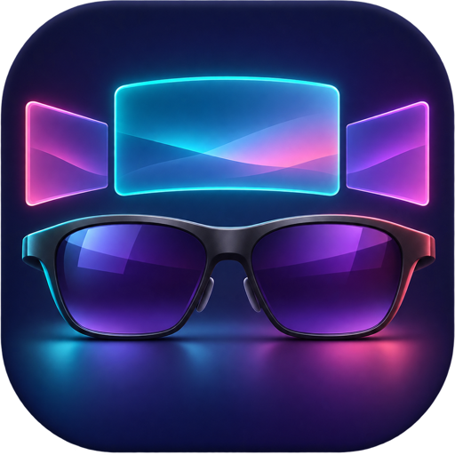

  

<h1 align="center">Sillen</h1>

  Your Mac windows, placed in space. 
  A macOS app for working and watching movies with XR glasses.

  <a href="README.fr.md">Français</a>

---

## What it is

Sillen takes **real windows from your Mac** — a browser, a mail client, a chat
app, a dashboard — and places them in a three-dimensional space in front of you.
They are not frozen copies: they are the windows themselves, kept up to date,
and you interact with them.

Turn your head and the scene follows. Put a screen on your left and it stays on
your left. Want a third one, a fourth one, further away or larger? That is a
setting, not a rebuild.

## What you can do

**Place your screens wherever you want.** One to twelve panels, arranged
on an arc in front of you, at the size and distance you choose. Each panel
follows a real window: change the tab and the panel changes.

**Look around without lifting a hand.** The glasses' head tracking moves the
cursor and reframes the scene. A recentring gesture brings everything back in
front of you once you have moved.

**A remote control inside the scene.** ⌃⌘T brings it up in front of you: your
desktop, your applications, the number of screens, each panel's source,
recentring, zoom. Everything is set without leaving the scene.

**Choose your backdrop.** Sky, ground, 360° panoramas, animated backgrounds or
your own image: every part is adjustable, and the ground blends into the horizon
without a seam.

**Cinema mode.** Start a movie on Netflix or Crunchyroll: Sillen notices the
playback, switches to a cinema room and leaves you to the screening. When the
movie ends, the desktop comes back exactly as you left it.

**A dashboard on the Mac.** Screens, panels, settings, glasses link status:
everything is driven from the Mac, without leaving the scene.

## How it works with the glasses

**The glasses are a display, not a computer.** Sillen sends them no video
stream. macOS sees a VITURE headset plugged into USB-C as an ordinary external
display, and Sillen draws its scene full screen on it. The Mac does all the
work — the 3D, the window capture, the video decoding. The glasses only show
the result.

**Plug in, then choose “Extend”.** When the glasses are connected, macOS asks
what to do with the new display. Choose **Extend**, never **Mirror**: in mirror
mode the glasses already show the Mac screen, and the scene has nowhere to go.
Their name then appears in the **Glasses** card, for instance “VITURE Pro 2”.

**Your head drives the view.** The headset reports the movement of your head.
Sillen turns it into the camera of the scene and into the cursor. Turn your head
and the panels stay where you put them. If the scene drifts away, ⌥R recentres
it.

**Two windows, two screens.** The dashboard stays on the Mac, in its own
window. The scene is another window, full screen on the glasses. Both are live
at the same time: you can change a panel or read the log while the scene keeps
running. ⌃⌘F switches the scene on, ⌃⌘G puts it back on the glasses after a
screen change.

**The whole range.** Head tracking is provided for the entire VITURE line: One,
Lite, Pro, Luma, Luma Pro, Luma Cyber, Beast, Phantom Beast, Pro 2 and Luma
Ultra.

> A black screen while extending almost always means macOS picked a format the
> panel refuses. The **View** menu has *Set up the glasses display (1920×1080
> 60 Hz)* to force an accepted one.

## Options

### Screens

- **One to twelve screens**, arranged on an arc in front of you.
- **Four starting points**: a single screen filling the field of view, a wall of
  side-by-side screens, a 360° desktop that rings your head, and cinema mode for
  one screen and one movie.
- **Angular spacing** between two screens — 45° by default. Beyond that you run
  out of head turn, hence overlapping panels.
- **Geometry**: diagonal (20" to 140", as printed on a TV box), width, height
  and distance for the whole set. Then, per screen, its angle, elevation, own
  depth and own brightness.
- **Overlap guard**: when two screens cover each other, Sillen says so and can
  spread them apart.
- **Saved layouts**, cycled with ⌥L.
- **Reading zoom** brings the focused screen closer without moving it.

### What a screen shows

- A **real window**: it follows the application and its title, so changing tab
  changes the panel.
- A **whole display** of the Mac.
- An **app-made tile** (notifications), which captures nothing.
- The **demonstration**, when no source has been chosen.

### Rendering

- Brightness of the screens, from 25 % to 100 %, adjustable per screen.
- Borders, in three styles: bezel, cinema, neon.
- Floor grid, cropping on the window content, frame rate cap.

### Backdrop

- Seven skies and rooms: none, northern lights, starry sky, sunset, nebula,
  retro neon, cinema hall.
- Your own 360° panoramas as a sky, your own textures as a floor.
- Drift speed, floor pattern size, and a separate panorama for the cinema
  session.

### Tracking and interface

- Sensitivity and smoothing of head tracking, recentring axis and recentring
  shortcut.
- **Demo mode**: synthetic movement and demonstration panels, so the app can be
  tried without the glasses.
- French or English interface.
- The settings column starts folded. ⌃⌘I unfolds it.

### Keyboard shortcuts

| Shortcut | What it does |
|---|---|
| ⌃⌘F | Scene on the glasses, on or off |
| ⌃⌘G | Put the scene back on the glasses |
| ⌃⌘T | Remote control, inside the scene |
| ⌃⌘I | Fold or unfold the settings |
| ⌥L | Next saved layout |
| ⌥R | Recentre the scene |
| Esc | Leave the scene |

## Screenshots

  

  <em>The Mac dashboard, running in demo mode. On the left are the glasses and
  the head-tracking attitude. In the middle, the XR scene itself, exactly as it
  is sent to the glasses. On the right, the layout of the screens. At the bottom,
  the live log.</em>

  

  <em>Cinema mode — the panel stays fixed in space while the room settles around
  you.</em>

  

## Requirements

- An Apple Silicon Mac
- macOS 14 or later
- VITURE glasses and their cable
- The **Screen Recording** permission (required: without it, every panel stays
  on demo content)
- The **Accessibility** permission (required to act on another application:
  bring a minimised window back, send a click)

## Installation

1. Download the latest version from the **Releases** tab of this repository.
2. Drag `Sillen.app` into the **Applications** folder.
3. Open it. macOS then asks for the two permissions.

The app is signed with a Developer ID and notarized by Apple: macOS opens it
without the “unidentified developer” warning.

## The two permissions, in detail

This is the only tricky part, and it is normal for it to be surprising: **macOS
no longer presents a prompt for the screen recording permission**, and the “+”
button in System Settings only browses the Applications folder.

The gesture that works:

1. Open **System Settings ▸ Privacy & Security ▸ Screen & System Audio
   Recording**.
2. Open the Finder on the **Applications** folder and **drag `Sillen.app` onto
   the pane's list**. Sillen appears there.
3. Tick it.
4. Do the same in **Accessibility** if it is not listed there already.
5. Quit Sillen (⌘Q) and launch it again: macOS only reads these grants when a
   process starts.

These grants are then kept from one update to the next, as long as the app is
signed by the same developer.

## Updates

Sillen checks at launch, then once a day, whether a newer version has been
published. It only **tells** you about it and opens the download page: nothing
installs without your gesture.

## Privacy

Everything stays on your Mac. Sillen sends no capture, no setting and no log,
and requires no account. The only network request it makes is to read a small
version file, to find out whether an update exists.

## This repository

This repository holds the app's presentation. The source code is not public.

Sillen is in active development: the features described here are those of the
current version and may change.
