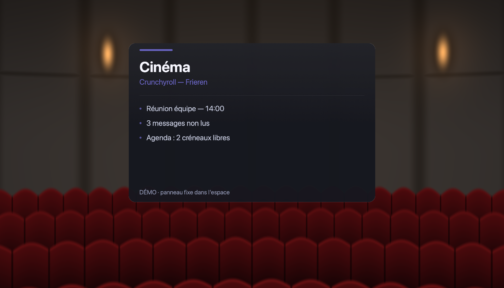

<p align="center">
  
</p>

<h1 align="center">Sillen</h1>

<p align="center">
  Your Mac windows, placed in space.<br>
  A macOS app for working and watching movies with XR glasses.
</p>

<p align="center">
  <a href="README.fr.md">Français</a>
</p>

---

## What it is

Sillen takes **real windows from your Mac** — a browser, a mail client, a chat
app, a dashboard — and places them in a three-dimensional space in front of you.
They are not frozen copies: they are the windows themselves, kept up to date,
and you interact with them.

Turn your head and the scene follows. Put a screen on your left and it stays on
your left. Want a third one, a fourth one, further away or larger? That is a
setting, not a rebuild.

## What you can do

**Place your screens wherever you want.** One to twelve panels, arranged
on an arc in front of you, at the size and distance you choose. Each panel
follows a real window: change the tab and the panel changes.

**Look around without lifting a hand.** The glasses' head tracking moves the
cursor and reframes the scene. A recentring gesture brings everything back in
front of you once you have moved.

**A remote control inside the scene.** ⌃⌘T brings it up in front of you: your
desktop, your applications, the number of screens, each panel's source,
recentring, zoom. Everything is set without leaving the scene.

**Choose your backdrop.** Sky, ground, 360° panoramas, animated backgrounds or
your own image: every part is adjustable, and the ground blends into the horizon
without a seam.

**Cinema mode.** Start a movie on Netflix or Crunchyroll: Sillen notices the
playback, switches to a cinema room and leaves you to the screening. When the
movie ends, the desktop comes back exactly as you left it.

**A dashboard on the Mac.** Screens, panels, settings, glasses link status:
everything is driven from the Mac, without leaving the scene.

## How it works with the glasses

**The glasses are a display, not a computer.** Sillen sends them no video
stream. macOS sees a VITURE headset plugged into USB-C as an ordinary external
display, and Sillen draws its scene full screen on it. The Mac does all the
work — the 3D, the window capture, the video decoding. The glasses only show
the result.

**Plug in, then choose “Extend”.** When the glasses are connected, macOS asks
what to do with the new display. Choose **Extend**, never **Mirror**: in mirror
mode the glasses already show the Mac screen, and the scene has nowhere to go.
Their name then appears in the **Glasses** card, for instance “VITURE Pro 2”.

**Your head drives the view.** The headset reports the movement of your head.
Sillen turns it into the camera of the scene and into the cursor. Turn your head
and the panels stay where you put them. If the scene drifts away, ⌥R recentres
it.

**Two windows, two screens.** The dashboard stays on the Mac, in its own
window. The scene is another window, full screen on the glasses. Both are live
at the same time: you can change a panel or read the log while the scene keeps
running. ⌃⌘F switches the scene on, ⌃⌘G puts it back on the glasses after a
screen change.

**The whole range.** Head tracking is provided for the entire VITURE line: One,
Lite, Pro, Luma, Luma Pro, Luma Cyber, Beast, Phantom Beast, Pro 2 and Luma
Ultra.

> A black screen while extending almost always means macOS picked a format the
> panel refuses. The **View** menu has *Set up the glasses display (1920×1080
> 60 Hz)* to force an accepted one.

## Options

### Screens

- **One to twelve screens**, arranged on an arc in front of you.
- **Four starting points**: a single screen filling the field of view, a wall of
  side-by-side screens, a 360° desktop that rings your head, and cinema mode for
  one screen and one movie.
- **Angular spacing** between two screens — 45° by default. Beyond that you run
  out of head turn, hence overlapping panels.
- **Geometry**: diagonal (20" to 140", as printed on a TV box), width, height
  and distance for the whole set. Then, per screen, its angle, elevation, own
  depth and own brightness.
- **Overlap guard**: when two screens cover each other, Sillen says so and can
  spread them apart.
- **Saved layouts**, cycled with ⌥L.
- **Reading zoom** brings the focused screen closer without moving it.

### What a screen shows

- A **real window**: it follows the application and its title, so changing tab
  changes the panel.
- A **whole display** of the Mac.
- An **app-made tile** (notifications), which captures nothing.
- The **demonstration**, when no source has been chosen.

### Rendering

- Brightness of the screens, from 25 % to 100 %, adjustable per screen.
- Borders, in three styles: bezel, cinema, neon.
- Floor grid, cropping on the window content, frame rate cap.

### Backdrop

- Seven skies and rooms: none, northern lights, starry sky, sunset, nebula,
  retro neon, cinema hall.
- Your own 360° panoramas as a sky, your own textures as a floor.
- Drift speed, floor pattern size, and a separate panorama for the cinema
  session.

### Tracking and interface

- Sensitivity and smoothing of head tracking, recentring axis and recentring
  shortcut.
- **Demo mode**: synthetic movement and demonstration panels, so the app can be
  tried without the glasses.
- French or English interface.
- The settings column starts folded. ⌃⌘I unfolds it.

### Keyboard shortcuts

| Shortcut | What it does |
|---|---|
| ⌃⌘F | Scene on the glasses, on or off |
| ⌃⌘G | Put the scene back on the glasses |
| ⌃⌘T | Remote control, inside the scene |
| ⌃⌘I | Fold or unfold the settings |
| ⌥L | Next saved layout |
| ⌥R | Recentre the scene |
| Esc | Leave the scene |

## Screenshots

<p align="center">
  
</p>

<p align="center">
  <em>The Mac dashboard, running in demo mode. On the left are the glasses and
  the head-tracking attitude. In the middle, the XR scene itself, exactly as it
  is sent to the glasses. On the right, the layout of the screens. At the bottom,
  the live log.</em>
</p>

<p align="center">
  
</p>

<p align="center">
  <em>Cinema mode — the panel stays fixed in space while the room settles around
  you.</em>
</p>

<p align="center">
  
</p>

## Requirements

- An Apple Silicon Mac
- macOS 14 or later
- VITURE glasses and their cable
- The **Screen Recording** permission (required: without it, every panel stays
  on demo content)
- The **Accessibility** permission (required to act on another application:
  bring a minimised window back, send a click)

## Windows

A Windows version is being studied, and I would rather say so than leave the
question unanswered. Nothing is published, nothing has a date, and it is not a
promise.

Why it cannot simply be built again: Sillen does not exist without macOS.
Drawing the scene, reading your windows, acting on the windows of another
application and the whole interface rest on parts of the system that have no
equivalent on Windows. Each of them would have to be written again from scratch.
What carries over is the geometry of the space, which is the smallest share of
the work. The glasses are not the difficulty. Their manufacturer publishes what
is needed on Windows as well.

What remains is not technical. One person, two platforms, means maintaining two
applications side by side, each with its own screens, its own capture and its own
faults to chase, and drifting a little further apart with every update. A second
version that lags behind is not a service. So I am looking at it, and I will only
start it if I can do it properly. Until then, Sillen is a macOS app.

## Installation

1. Download `Sillen-0.2-2.dmg` from the **Releases** tab and open it.
2. Drag **Sillen** onto the **Applications** folder in the window that appears.
3. Launch it from Applications. macOS then asks for the two permissions.

Launch it from Applications, not from the mounted image or from your Downloads
folder: macOS otherwise runs the app from a temporary read-only location, where
the permissions do not stick and updates cannot be applied. A zip of the same
app is published alongside the image, if you prefer to unzip it yourself.

The app is signed with a Developer ID and notarized by Apple: macOS opens it
without the “unidentified developer” warning.

## Checking the download

A small app from a developer you have never heard of deserves a check rather
than blind trust — but a hash covers **one exact file**, the archive you
downloaded, not the app inside it. There is therefore one hash per download,
and the two differ on purpose.

```sh
# if you took the disk image
shasum -a 256 Sillen-0.2-2.dmg
# d7eaddd91632041ee4a53fd2b04d97909fac0bbe8cf27f0b10723c2aa3205017

# if you took the zip
shasum -a 256 Sillen-0.2-2.zip
# f6c31135c024104305d80074491e9242768ac6961ae110f038f91655b9e39043
```

If Safari has already unzipped the archive for you, hash the original file from
your Downloads folder before opening it. If it is gone, skip the hash and check
the installed app instead — it is a folder, so a hash means nothing there, but
the signature does:

```sh
codesign --verify --deep --strict --verbose=2 /Applications/Sillen.app
spctl -a -v -t exec /Applications/Sillen.app
# accepted · source=Notarized Developer ID
```

That verdict comes from Apple, not from me: it proves the copy in your
Applications folder is the one I signed and Apple scanned. If a hash ever
differs from the one above, do not install the file and open an issue.

## If an antivirus raises an alarm

It can happen, and it is not, by itself, evidence about what the app does.
Sillen does two things that security software is built to watch for: it reads the
image of your windows, and it acts on other applications. A heuristic sees that
pattern and calls it spyware. That is the usual scenario, not a proof. Add a
binary published a few days ago, signed by a developer with no established
reputation, shipping two libraries from the glasses manufacturer, and there is
plenty there to produce a false positive.

**Do not disable your antivirus to use Sillen.** Check, instead:

- the hash and the notarization above;
- the file your antivirus names in its report — the app itself, or one of the
  two libraries that come with it;
- what it shows you about network activity: Sillen contacts one address,
  `raw.githubusercontent.com`, to read a version file.

Then open an issue with the antivirus name, its version, the exact file it
flagged and the message. If it turns out to be a false positive, reporting it to
the vendor is the developer's job — Microsoft, WithSecure, Fortinet, ESET and the
others all have a form for this — and the correction usually arrives in a
definition update. Telling me about it here as well is what gets it looked at.

## Scanning it with other engines

If you want an opinion that does not come from me, upload the file you downloaded
to VirusTotal or MetaDefender. Both run it through dozens of engines at once and
show you each verdict separately.

A detection is not a verdict by itself. Read the list as a whole, and look at
three things.

- **How many engines, and which ones.** One or two out of several dozen, on a
  file Apple has signed and notarized, more often points at a single engine's own
  heuristic than at a find the others all missed. It is not proof either way.
- **Which file was named.** The app itself, or one of the two libraries that come
  with it, which are supplied by the glasses manufacturer and identical for every
  user of its software.
- **What the engine calls it.** A generic name — heuristic, generic, machine
  learning attribute — describes a behaviour, and a behaviour is exactly what
  Sillen looks like from outside. A precise family name, repeated across engines
  and scans, is another matter and I want to be told about it.

If your scan falls in that last case, open an issue with the link to the report.
A heuristic detection can be reported to the vendor, and it often disappears in a
definition update. A real detection would not disappear, and it would have to be
dealt with. I would rather learn about that from you.

One caution. These services keep what is sent to them and share it with partners.
What you send is the app, which is already public, so nothing of yours is
exposed. Do not upload a screenshot of your desktop or a document, only
`Sillen-0.2-2.dmg` or `Sillen-0.2-2.zip`. The hashes above are there to confirm
that you scanned the same file I published.

## The two permissions, in detail

This is the only tricky part, and it is normal for it to be surprising: **macOS
no longer presents a prompt for the screen recording permission**, and the “+”
button in System Settings only browses the Applications folder.

The gesture that works:

1. Open **System Settings ▸ Privacy & Security ▸ Screen & System Audio
   Recording**.
2. Open the Finder on the **Applications** folder and **drag `Sillen.app` onto
   the pane's list**. Sillen appears there.
3. Tick it.
4. Do the same in **Accessibility** if it is not listed there already.
5. Quit Sillen (⌘Q) and launch it again: macOS only reads these grants when a
   process starts.

These grants are then kept from one update to the next, as long as the app is
signed by the same developer.

## Updates

Sillen checks at launch, then once a day, whether a newer version has been
published. It only **tells** you about it and opens the download page: nothing
installs without your gesture.

## Privacy

Everything stays on your Mac. Sillen sends no capture, no setting and no log,
and requires no account. The only network request it makes is to read a small
version file, to find out whether an update exists.

## Why the app only, and why not the App Store

This repository holds the app's presentation, not its source code. I know exactly
where the doubt starts, because it would start with me too: an application you
cannot read is an application you have to take on faith. What I can put in place
of the code is on this page. The download is checked by Apple before publication
and can be checked by you afterwards. The page says what the app does, what it
asks your Mac for, what it sends over the network and what it keeps on disk.

The reason for keeping the code is simple, and I will not dress it up. Sillen is
one person's work, and its value lies in the hours spent making window capture,
head tracking and the scene hold together. I keep it because it is that work.

What I will not claim is that this choice is free. The signature proves that the
app is intact and that it comes from me, and notarization that Apple scanned it
and found nothing. What neither proves is that the file you downloaded is the one
I published — that is what the hash on this page is for. None of it is an audit of
what the app does while it runs, and none of it replaces someone reading the
code. A reader would know more than you can know today. That is the price of
keeping the source, and I prefer to say so rather than leave it unsaid.

The App Store is another matter, and it is not a choice I made. Sillen has to act
on other applications, for instance bringing back a minimised window or passing a
click to a panel. Apps sold on the App Store run inside a sandbox, and that
sandbox does not allow them to act on the windows of another application. I tried
it on the app itself: with the App Store entitlements and the sandbox active, the
system refuses before the permission request can even be shown. I am not saying
that no app will ever be able to do this. I am saying that Sillen, as it stands,
is not compatible with those constraints, and that a version giving up acting on
windows would be a viewer, unable to use what it displays. So I ship the version
that works, here, and I explain how it is checked.

## Nobody has to install it

Nothing obliges you to install anything. Sillen asks for no account, no
subscription and none of your data. It also comes with no warranty of any kind:
it is offered as it is, used at your own risk, and it may stop being maintained
tomorrow if I stop working on it. If it does not suit you, drag it to the Trash
and delete `~/Library/Application Support/Sillen`. Nothing remains on your Mac.

Sillen is in active development: the features described here are those of the
current version and may change.
