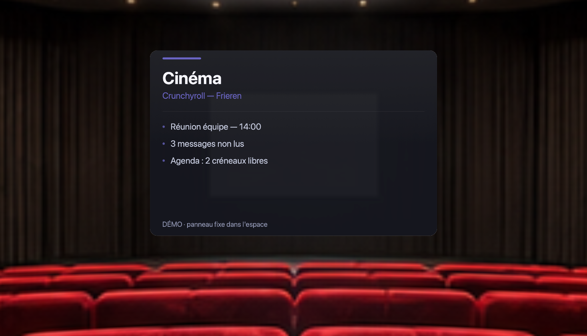

  

<h1 align="center">Sillen</h1>

  Vos fenêtres Mac, posées dans l'espace. 
  Une application macOS pour travailler et regarder des films avec des lunettes XR.

---

## Ce que c'est

Sillen récupère de **vraies fenêtres de votre Mac** — un navigateur, un mail, une
messagerie, un tableau de bord — et les affiche dans un espace en trois
dimensions, devant vous. Ce ne sont pas des copies figées : ce sont les fenêtres
elles-mêmes, mises à jour en continu, avec lesquelles vous interagissez.

Vous tournez la tête, la scène suit. Vous posez un écran à gauche, il reste à
gauche. Vous en voulez un troisième, un quatrième, plus loin ou plus grand :
c'est un réglage, pas une reconstruction.

## Ce qu'on peut faire

**Poser ses écrans où l'on veut.** Un à huit panneaux, disposés sur un arc
devant vous, à la taille et à la distance de votre choix. Chaque panneau suit une
vraie fenêtre : si vous changez d'onglet, le panneau change.

**Regarder sans lever les mains.** Le suivi de tête des lunettes déplace le
curseur et recadre la scène. Un geste de recentrage ramène tout devant vous si
vous vous êtes déplacé.

**Poser un écran depuis le téléphone.** La télécommande permet de placer un
panneau d'un geste, sans quitter le clavier.

**Choisir son décor.** Ciel, sol, panoramas à 360°, fonds animés ou image
personnelle : chaque élément se règle, et le sol se fond dans l'horizon sans
couture.

**Le mode cinéma.** Lancez un film sur Netflix ou Crunchyroll : Sillen reconnaît
la lecture, bascule dans une salle de cinéma et vous laisse la séance. À la fin
du film, le bureau revient exactement comme vous l'aviez laissé.

**Un tableau de bord sur le Mac.** Écrans, panneaux, réglages, état de la
liaison aux lunettes : tout se pilote depuis le Mac, sans quitter la scène.

## Aperçu

  

  <em>Mode cinéma — le panneau reste fixe dans l'espace, la salle s'installe
  autour de vous.</em>

  

## Configuration requise

- Un Mac à processeur Apple Silicon
- macOS 14 ou plus récent
- Des lunettes VITURE et leur câble
- L'autorisation « Enregistrement de l'écran » (indispensable : sans elle,
  chaque panneau reste sur un contenu de démonstration)
- L'autorisation « Accessibilité » (indispensable pour agir sur une autre
  application : ramener une fenêtre réduite, envoyer un clic)

## Installation

1. Téléchargez la dernière version depuis l'onglet **Releases** de ce dépôt.
2. Faites glisser `Sillen.app` dans le dossier **Applications**.
3. Ouvrez-la. macOS demande alors les deux autorisations.

## Les deux autorisations, en détail

C'est le seul passage délicat, et il est normal qu'il surprenne : **macOS ne
propose plus de fenêtre pour l'autorisation d'enregistrement de l'écran**, et le
bouton « + » des Réglages ne parcourt que le dossier Applications.

Le geste qui fonctionne :

1. Ouvrez **Réglages Système ▸ Confidentialité et sécurité ▸ Enregistrement de
   l'écran et des sons système**.
2. Ouvrez le Finder sur le dossier **Applications**, et **faites glisser
   `Sillen.app` sur la liste** du panneau. Sillen y apparaît.
3. Cochez-la.
4. Faites de même dans **Accessibilité** si elle n'y figure pas déjà.
5. Quittez Sillen (⌘Q) et relancez-la : macOS ne lit ces accords qu'au démarrage
   d'un processus.

Ces accords sont ensuite conservés d'une mise à jour à l'autre, tant que
l'application est signée par le même éditeur.

## Mises à jour

Sillen vérifie au lancement, puis une fois par jour, si une version plus récente
est publiée. Elle se contente de vous **signaler** la nouvelle version et
d'ouvrir la page de téléchargement : rien ne s'installe sans votre geste.

## Vie privée

Tout reste sur votre Mac. Sillen ne transmet ni capture, ni réglage, ni journal,
et ne demande aucun compte. La seule requête réseau qu'elle émet est la lecture
d'un petit fichier de version, pour savoir si une mise à jour existe.

## Ce dépôt

Ce dépôt contient la présentation de l'application. Le code source n'est pas
public.

Sillen est en développement actif : les fonctions décrites ici sont celles de la
version courante, et peuvent évoluer.
