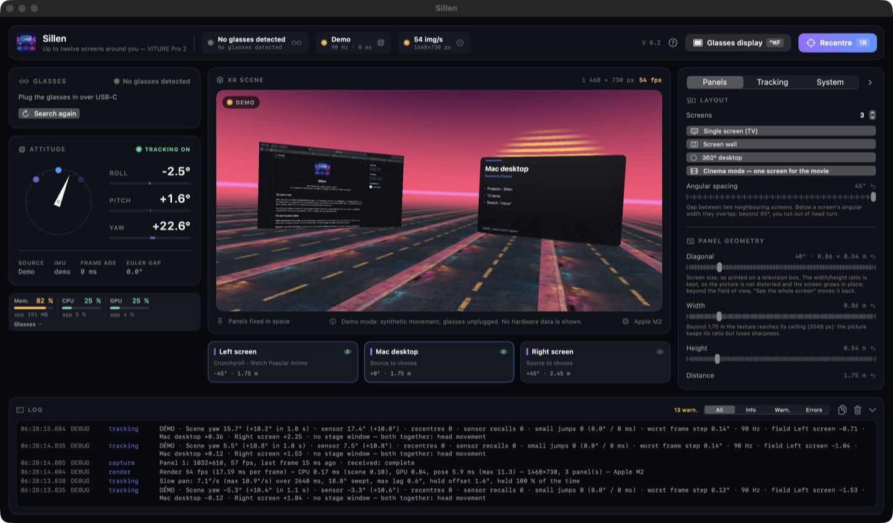

  

<h1 align="center">Sillen</h1>

  Your Mac windows, placed in space. 
  A macOS app for working and watching movies with XR glasses.

  <a href="README.fr.md">Français</a>

---

## What it is

Sillen takes **real windows from your Mac** — a browser, a mail client, a chat
app, a dashboard — and places them in a three-dimensional space in front of you.
They are not frozen copies: they are the windows themselves, kept up to date,
and you interact with them.

Turn your head and the scene follows. Put a screen on your left and it stays on
your left. Want a third one, a fourth one, further away or larger? That is a
setting, not a rebuild.

## What you can do

**Place your screens wherever you want.** One to eight panels, arranged on an
arc in front of you, at the size and distance you choose. Each panel follows a
real window: change the tab and the panel changes.

**Look around without lifting a hand.** The glasses' head tracking moves the
cursor and reframes the scene. A recentring gesture brings everything back in
front of you once you have moved.

**Place a screen from your phone.** The remote control lets you drop a panel in
a single gesture, without leaving the keyboard.

**Choose your backdrop.** Sky, ground, 360° panoramas, animated backgrounds or
your own image: every part is adjustable, and the ground blends into the horizon
without a seam.

**Cinema mode.** Start a movie on Netflix or Crunchyroll: Sillen notices the
playback, switches to a cinema room and leaves you to the screening. When the
movie ends, the desktop comes back exactly as you left it.

**A dashboard on the Mac.** Screens, panels, settings, glasses link status:
everything is driven from the Mac, without leaving the scene.

## Screenshots

  

  <em>The Mac dashboard, running in demo mode. On the left, the glasses and the
  head-tracking attitude; in the middle, the XR scene itself, exactly as it is
  sent to the glasses; on the right, the layout of the screens; at the bottom,
  the live log.</em>

  

  <em>Cinema mode — the panel stays fixed in space while the room settles around
  you.</em>

  

## Requirements

- An Apple Silicon Mac
- macOS 14 or later
- VITURE glasses and their cable
- The **Screen Recording** permission (required: without it, every panel stays
  on demo content)
- The **Accessibility** permission (required to act on another application:
  bring a minimised window back, send a click)

## Installation

1. Download the latest version from the **Releases** tab of this repository.
2. Drag `Sillen.app` into the **Applications** folder.
3. Open it. macOS then asks for the two permissions.

## The two permissions, in detail

This is the only tricky part, and it is normal for it to be surprising: **macOS
no longer presents a prompt for the screen recording permission**, and the “+”
button in System Settings only browses the Applications folder.

The gesture that works:

1. Open **System Settings ▸ Privacy & Security ▸ Screen & System Audio
   Recording**.
2. Open the Finder on the **Applications** folder and **drag `Sillen.app` onto
   the pane's list**. Sillen appears there.
3. Tick it.
4. Do the same in **Accessibility** if it is not listed there already.
5. Quit Sillen (⌘Q) and launch it again: macOS only reads these grants when a
   process starts.

These grants are then kept from one update to the next, as long as the app is
signed by the same developer.

## Updates

Sillen checks at launch, then once a day, whether a newer version has been
published. It only **tells** you about it and opens the download page: nothing
installs without your gesture.

## Privacy

Everything stays on your Mac. Sillen sends no capture, no setting and no log,
and requires no account. The only network request it makes is to read a small
version file, to find out whether an update exists.

## This repository

This repository holds the app's presentation. The source code is not public.

Sillen is in active development: the features described here are those of the
current version and may change.
